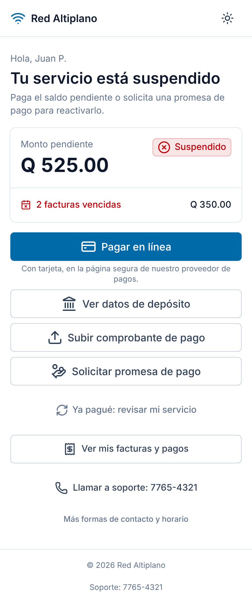
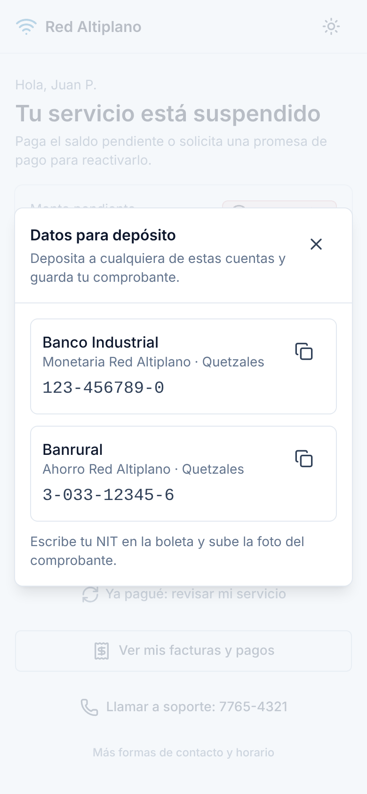
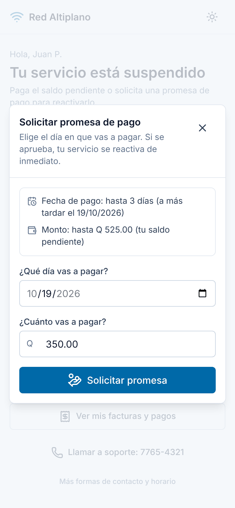
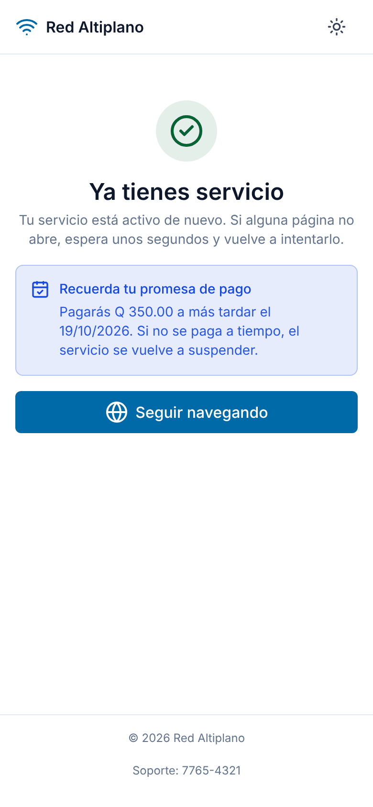
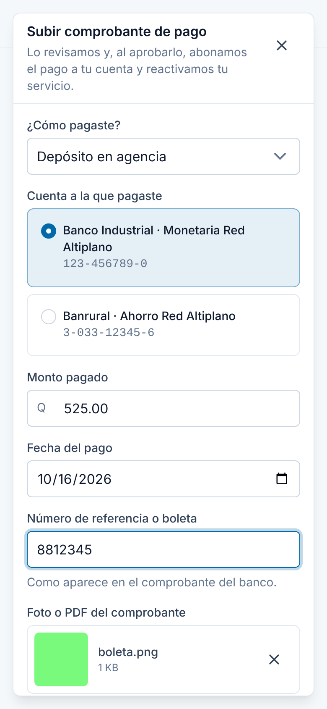
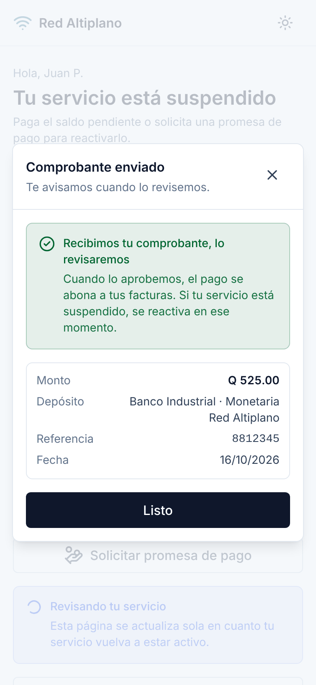
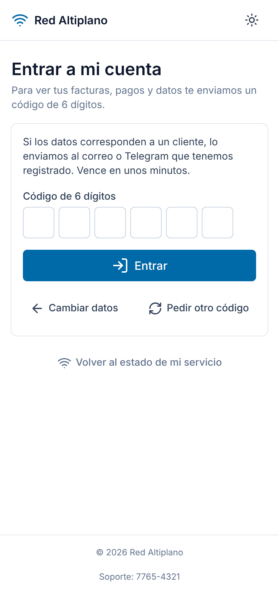
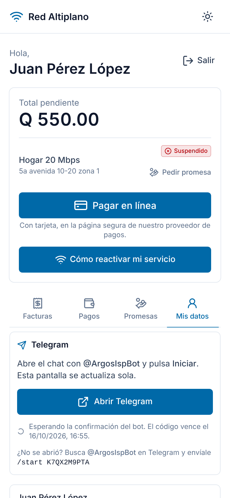
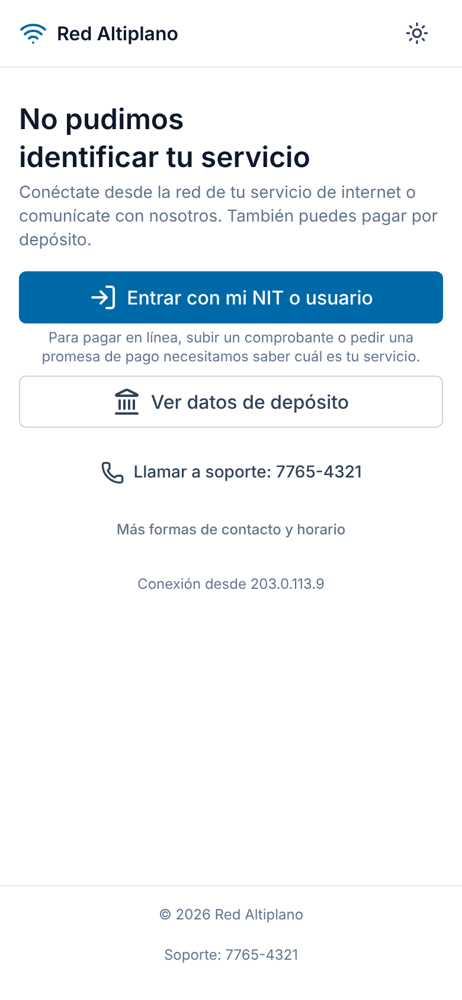

# Portal del cliente: guía para el piloto

Para el personal del ISP (caja, soporte, cobranza). Explica qué ve un cliente con el servicio
cortado y cómo se resuelve solo desde el teléfono. Las capturas son del portal a 390 px (un
teléfono común); los nombres, montos y cuentas son de prueba.

## 1. Qué ve un cliente cortado

Cuando el servicio está suspendido, cualquier página que el cliente abra (y el aviso "Iniciar sesión
en la red" que muestran Android, iPhone y Windows) lo lleva a la **página de corte**. El portal lo
reconoce por la conexión, sin usuario ni contraseña.

Ve solo lo necesario: su primer nombre con una inicial, el estado del servicio, el monto pendiente y
cuántas facturas están vencidas. Nunca su nombre completo, NIT, dirección ni teléfono.

Desde ahí puede:

- **Pagar en línea** con tarjeta (si la empresa tiene pasarela; si no, el botón aparece apagado).
- **Ver datos de depósito**: las cuentas de la empresa y las instrucciones de pago, con botón para
  copiar el número.
- **Subir comprobante de pago** de un depósito o transferencia.
- **Solicitar promesa de pago** para reactivar ya y pagar después.
- **Llamar a soporte** con el teléfono configurado en el panel.

Las cuentas, el teléfono, el horario y las instrucciones se cambian en el panel:
**Configuración · Empresa** y **Configuración · Cuentas bancarias**.

## 2. Cómo promete pago

1. Toca **Solicitar promesa de pago**.
2. El portal muestra los límites antes de enviar: hasta qué día puede prometer y el monto máximo
   (y, si la plantilla lo pide, el abono inicial o si requiere aprobación).
3. Elige el día y el monto (vienen llenos con la fecha máxima y el saldo vencido) y toca
   **Solicitar promesa**.

La respuesta es inmediata:

- **Aprobada**: el servicio se reactiva en segundos y la página cambia sola a "Ya tienes servicio",
  con el recordatorio de la fecha. El botón **Seguir navegando** lo devuelve a internet.
- **Pendiente de aprobación**: la plantilla del cliente exige que alguien la apruebe en el panel
  (**Promesas**). Al aprobarla, el servicio vuelve.
- **Rechazada**: el portal dice el motivo en palabras simples (por ejemplo, "la fecha pasa del
  plazo" o "ya usaste tus promesas de este mes") y, si se puede corregir, ofrece cambiar fecha o
  monto; si no, contactar a la oficina.

Las reglas (plazo, cantidad por mes, abono, aprobación) son las de la plantilla del cliente en el
panel; el portal no decide nada por su cuenta.

## 3. Cómo sube un comprobante

1. Toca **Subir comprobante de pago**.
2. Elige cómo pagó (depósito, transferencia, ACH o remesa) y la cuenta a la que pagó.
3. Escribe el monto, la fecha y el número de boleta o referencia.
4. Toma una foto con la cámara o elige el archivo (foto JPG, PNG o WebP, o PDF, hasta 5 MB) y toca
   **Enviar comprobante**.

El comprobante **no reactiva solo**: queda en revisión en el panel (**Comprobantes**). Cuando
caja o cobranza lo aprueba, el pago se abona a sus facturas y, si estaba suspendido, el servicio
vuelve en segundos. Si se rechaza, el cliente ve el motivo en **Mi cuenta · Pagos**.

Para que el cliente no tenga que volver a preguntar: si deja la página abierta, se actualiza sola
cuando el servicio vuelve.

## 4. Cómo vincula Telegram

Telegram sirve para recibir avisos (factura, vencimiento, corte) y el código de acceso al portal.

1. En la página de corte, **Ver mis facturas y pagos** (o entrar al portal y elegir **Entrar**).
2. Pide el código: le llega al correo registrado (o a Telegram, si ya lo tenía vinculado).
   Escribe los 6 dígitos.
3. En **Mi cuenta**, pestaña **Mis datos**, toca **Vincular Telegram** y luego **Abrir Telegram**.
4. En Telegram, toca **Iniciar**. La pantalla del portal cambia sola a "Vinculado".

Si el enlace no abre Telegram, el portal muestra el mensaje para enviar a mano (`/start` y el
código). El código vence en unos minutos; se puede pedir otro. Una vez vinculado, puede elegir
Telegram como canal preferido en la misma pestaña.

## 5. Dudas frecuentes

**"Abro cualquier página y me sale el aviso de corte."**
Es lo esperado mientras el servicio está suspendido. Al pagar, prometer o al aprobar su comprobante,
vuelve solo; no hace falta reiniciar el router.

**"Dice *No pudimos identificar tu servicio*."**
Está conectado desde otra red (datos móviles, otro wifi) o su equipo aún no tiene sesión. Puede
**Entrar con mi NIT o usuario** y hacer todo desde **Mi cuenta**, o ver los datos de depósito.
Si está en su casa y sigue saliendo, que reinicie el router; si persiste, revisar su sesión PPPoE.

**"Ya pagué en el banco y sigo sin servicio."**
El depósito se aplica cuando el comprobante se aprueba. Pídale que lo suba desde el portal (o
regístrelo en caja). Al aprobarlo vuelve en segundos.

**"Me rechazó la promesa."**
El motivo aparece en pantalla. Las causas comunes: la fecha pasa del plazo permitido, ya usó las
promesas del mes, tiene una promesa sin cumplir o debe un abono antes. Revise la plantilla del
cliente en el panel si cree que es un error.

**"No me llega el código para entrar."**
Va al correo registrado (o a Telegram, si está vinculado y es su canal preferido). Revise que el
correo del cliente esté bien en el panel. Hay un máximo de 5 códigos por hora; cada código vence en
unos minutos.

**"Me sale *Demasiadas consultas*."**
El portal limita las consultas por conexión para protegerse. Basta esperar un minuto.

**"Me sale *No pudimos consultar tu servicio* o *No pudimos contactar al sistema*."**
El sistema no respondió. El portal no muestra montos inventados: hay que tocar **Reintentar**. Si
dura más de unos minutos, avisar a soporte técnico. Mientras tanto el cliente sigue viendo los
datos de depósito y el teléfono de soporte.

**"¿Alguien puede ver mis datos desde mi conexión?"**
Desde la conexión solo se ve el primer nombre con una inicial y los montos. Facturas, pagos y datos
de contacto piden el código que llega al correo o Telegram del cliente; la sesión se cierra sola a
los 30 minutos sin uso.

**"Tengo dos servicios."**
La página de corte muestra el servicio de la conexión desde la que entra. En **Mi cuenta** ve todos,
cada uno con su saldo, y al pagar en línea elige cuál pagar.
